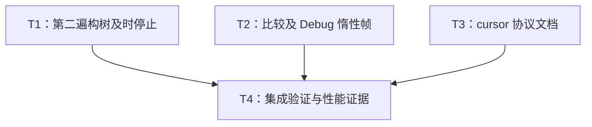

# rs-json 定向性能与内部协议文档改进实施计划

> 面向后续实施者：使用 executing-plans 按任务推进，步骤用复选框记录。当前文档交付不启动实施；后续实施授权到达后按本计划完成代码、测试、性能证据和集成检查。

**目标：** 完成 JSON-R01、JSON-R02、JSON-R03，保持公开合同与下游调用兼容。

**架构：** 第二遍构树复用 fallible consumer；比较与 Debug 用惰性 iterator 帧；定点补齐内部协议文档。不新增公开 API 或依赖。

**技术栈：** Rust 2024 / MSRV 1.94、serde_json、现有 qubit-budget、Criterion、现有分配计数器。

**目标项目：** `/data/working/qubit/rust-common/rs-json`。

**设计文档：** [设计文档](design-20261028T230324333Z-d0061497.md)。本计划按用户指定保存在项目 doc 目录，不创建临时计划目录。

## 采纳范围和约束

| 条目 | 实施归属 | 采纳状态 |
| --- | --- | --- |
| JSON-R01 | T1，T4 汇总证据 | 全部纳入，P2 |
| JSON-R02 | T2，T4 汇总证据 | 全部纳入，P2 |
| JSON-R03 | T1/T2 随代码补文档，T3 补 cursor，T4 核对 | 全部纳入，P3 |

用户未限定采纳范围，无明确搁置或拒绝项。不增加 JCS 公共返回类型入口、不扩展到下游迁移或全库重构。

持续规则：中文沟通；只修改任务直接相关内容；CI 只验证当前 crate，不加入或保留 downstream all-features 测试；保留已有用户变更；文件删除、移动等依授权处理；不创建或打开新的 Paseo workspace。提交和推送按实施命令及有效仓库规则判断，本计划本身不授予这些权限。

实施前读取适用的 Rust 源码、注释、测试规则。需要 Shell 或改变 Git 状态的操作再读取相应按需规则。所有生产 Rustdoc 使用英文。实施若发现相关文件已变化，先核对差异及合同，不能盲用评审行号。

## 调度图

以下“并行批次”表示写入集合可独立推进，不要求启用代理；没有显式代理授权时，可由同一执行者顺序完成。所有重型命令属于同一 Cargo target 资源组，串行执行。

| 任务 | 前置任务 | 最小解锁产物 | 写入集合（项目内相对路径） | 本地验证 | 集成验证归属 | 审查时机 |
| --- | --- | --- | --- | --- | --- | --- |
| T1（批次 A） | 无 | builder consumer 与两个调用方、定向回归可编译 | `src/value/internal/lexical_json_value_builder.rs`；`src/decode/internal/json_decode_engine.rs`；`src/tests/j3/composition_tests.rs`；`tests/decode/json_decode_composition_tests.rs`；`tests/decode/jcs_decoder_tests.rs`；`benches/unique_decode_bench.rs` | unique-seed/JCS 聚焦测试、第二遍停止测试 | T4 | 立即审查 |
| T2（批次 A） | 无 | 惰性帧与读取 helper、语义回归可编译 | `src/value/internal/json_value_read_ops.rs`；新增 `src/value/internal/json_value_compare_frame.rs`、`json_value_debug_action.rs`；`src/value/internal/mod.rs`；`tests/value/safe_json_value_tests.rs`；`tests/value/json_value_ref_tests.rs`；`benches/tree_bench.rs`；新增 `benches/value_read_allocations.rs`；`Cargo.toml` | owner/view 聚焦测试，默认及 preserve_order | T4 | 立即审查 |
| T3（批次 A） | 无 | cursor 文档与现有实现对应 | `src/lexical/internal/json_lexical_cursor.rs`（仅文档） | 逐字段/方法人工核对 | T4 | 批量审查 |
| T4（批次 B） | T1、T2、T3 | 所有局部产物已集成、局部回归通过 | `doc/benchmark_baseline.md`、`doc/benchmark_baseline.zh_CN.md`；本实施计划进度记录 | 统一格式、风格、CI、性能及私有 rustdoc | T4 唯一负责 | 立即审查 |

## 任务拓扑依赖图



T1/T2 的写入集合不重叠，但不得同时运行争用同一 Cargo target 的重型命令。T4 拥有 benchmark 双语记录，避免并行覆盖。最小解锁产物无需以 Git commit 为前提。

## T1：第二遍构树首次失败即停止（JSON-R01，部分 JSON-R03）

**输入依赖：** 现有 `JsonLexicalConsumer<'input>`、`JsonLexicalScanError`、`LexicalJsonValueBuilder`。

**输出接口：** 为 builder 增加内部 trait 实现，`type Error = JsonValueMaterializationError`；公开 decode 签名不变。

- [ ] 在修改前为 unique-seed 与 JCS 记录早重复键加 1 KiB、64 KiB、1 MiB 合法尾部的当前性能。沿用 `benches/unique_decode_bench.rs`，fixture 在计时外创建，断言只在计时外执行。JCS 案例使用 feature gate，确保默认 bench 仍可编译。输入构造如下：

```rust
let input = format!(r#"{{"x":0,"x":1,"tail":"{}"}}"#, "a".repeat(tail_bytes));
```

- [ ] 在 `src/tests/j3/composition_tests.rs` 增加内部 consumer 停止回归：直接让 builder 消费 `br#"{"x":0,"x":1,"tail":]"#`，期待 `JsonLexicalScanError::Consumer(JsonValueMaterializationError::DuplicateKey { .. })`，而不是扫描尾部后的 `Lexical`。内部测试不扩大生产可见性。尚未实现 trait 时先记录编译失败，最小 trait 实现完成后再确认停止合同；公开正确性回归在旧实现上可以通过，不伪造行为失败。
- [ ] 在 `tests/decode/json_decode_composition_tests.rs` 用 `decode_unique_seed_utf8` 和现有 seed fixture（或 `PhantomData::<serde_json::Value>`）验证：合法尾部重复键拒绝、重复键后非法语法返回 InvalidJson、后续数字超预算返回 Budget、seed 不被调用、失败后可复用。JCS 对应扩展现有 `test_jcs_decoder_complete_admission_precedes_materialization_errors`，保留坐标、隐私及回滚断言。
- [ ] 实现 trait，必要导入放在顶部，每条 use 一个对象。核心实现如下，所有方法加英文 Rustdoc：

```rust
impl<'input> JsonLexicalConsumer<'input> for LexicalJsonValueBuilder {
    type Error = JsonValueMaterializationError;

    fn before_value(&mut self, _depth: usize, _offset: usize) -> Result<(), Self::Error> {
        Ok(())
    }
    fn before_key(&mut self, _offset: usize) -> Result<(), Self::Error> {
        Ok(())
    }
    fn before_number(&mut self, _token: &'input str, _offset: usize) -> Result<(), Self::Error> {
        Ok(())
    }
    fn event(&mut self, event: JsonLexicalEvent<'input>) -> Result<(), Self::Error> {
        self.try_accept(event)
    }
}
```

- [ ] 只替换两个目标路径第二遍 `.scan_with_events(...)` 为 `.scan_with_consumer(input, &mut builder)`。保留原 `prepare_attempt`、数字模型、关闭重复计量配置和 commit 位置。`Consumer(_)` 走原 `builder.finish_guarded()` 首错映射，`Lexical` 沿原映射；`EncodedStringLimit` 用局部配置不可能启用的内部不变量明确处理，不吞错、不新增公共错误类型。JCS 的外层包装保持不变。
- [ ] 给 builder 的四个字段与 `accept_inner`、`accept_decoded_key_inner`、`try_push_value` 补英文 Rustdoc，说明已准入事件、配对帧、pending key、首错保留、部分树清理及 trait 回调前提。
- [ ] 串行运行聚焦命令：

```bash
cargo test --locked --lib tests::j3::composition_tests
cargo test --locked --test tests decode::json_decode_composition_tests
cargo test --locked --test tests --features jcs decode::jcs_decoder_tests
```

预期全部通过，且实际运行数大于零；新旧公开错误优先级一致。失败先定位原因，不更改合同绕过测试。性能复测交 T4。

## T2：比较与 Debug 改为惰性帧（JSON-R02，部分 JSON-R03）

**输入依赖：** 当前 `values_equal(&Value, &Value) -> bool` 与 `debug_value(&Value, &mut fmt::Formatter<'_>) -> fmt::Result`。

**输出接口：** 两个 helper 签名不变；新增类型仅内部可见，不改变 owner/view API。

- [ ] 修改前保存基准：宽度 32、512、8192，数组和对象各测 owner/view 相等、首项不等、尾项不等；Debug 使用丢弃输出 sink、固定前缀失败 sink。新增 `benches/value_read_allocations.rs`，按现有分配 binary 模式复用计数器：

```rust
#[path = "unique_decode_support/allocation_counter.rs"]
mod allocation_counter;
```

在 Cargo 增加 `[[bench]]`，`name = "value_read_allocations"`、`harness = false`。setup、预热、断言及打印放在 `measure` 外。不新增依赖，不改现有计数器。

- [ ] 在现有 owner/view 测试文件增加宽树语义、不同插入顺序对象相等、缺键、深浅混合以及 writer 提前失败测试。对 Debug 使用独立固定预期：

```rust
let owner = SafeJsonValue::new(serde_json::json!([null, true, {"a": 7}]));
assert_eq!(format!("{owner:?}"), "Array [Null, Bool(true), Object {\"a\": Number(7)}]");
```

保留 4096 层小栈测试和现有全类型测试，不以两个共用 helper 的输出相等替代固定预期。性能优化前这些行为测试可以通过，分配基线则显示随宽度增长。

- [ ] 在 `json_value_compare_frame.rs` 定义并文档化一个帧枚举，精确职责如下：

```rust
pub(super) enum JsonValueCompareFrame<'a> {
    Array {
        left: std::slice::Iter<'a, serde_json::Value>,
        right: std::slice::Iter<'a, serde_json::Value>,
    },
    Object {
        left: serde_json::map::Iter<'a>,
        right: &'a serde_json::Map<String, serde_json::Value>,
    },
}
```

实际源码按规则顶部导入对象后使用短名，为类型、字段、方法补文档。帧逐次产生一个子节点对；对象找不到键时返回不等，不能把“缺键”与“迭代结束”合并。数组进入前已检查长度。`values_equal` 以当前 pair 和祖先帧栈推进，不 `collect`、不压入全部兄弟节点、不克隆输入。

- [ ] 在 `json_value_debug_action.rs` 定义带 `Value(&Value)`、`Text(&'static str)`、`Key(&str)` 和数组/对象 iterator continuation 的枚举；continuation 记录是否已输出首项。展开时只调度一个孩子及常数个标点 action。空容器直接关闭，嵌套容器复用同一循环；所有格式写入使用 `?` 立即传播失败。移除原局部 `Action` 定义，在 `internal/mod.rs` 声明两个新模块并保持最小可见性。
- [ ] 给两个 helper 补英文 Rustdoc：键语义、对象迭代顺序、writer 失败、非递归、O(depth) 辅助空间，不含输入与外部输出存储。不要为此改 owner/view 的公开签名或添加预算参数。
- [ ] 在 `benches/tree_bench.rs` 增加上述形状的时间案例，setup 在计时外，使用 `black_box`；不加计时断言。分配 binary 输出包含 shape、width/depth、owner/view、operation、成功/提前失败、allocation_count、allocated_request_bytes，清楚标注不是峰值存活内存。
- [ ] 串行运行：

```bash
cargo test --locked --test tests value::safe_json_value_tests
cargo test --locked --test tests value::json_value_ref_tests
cargo test --locked --test tests --features serde_json/preserve_order value::safe_json_value_tests
cargo test --locked --test tests --features serde_json/preserve_order value::json_value_ref_tests
```

预期运行数大于零且全部通过；对象不同插入顺序仍相等，Debug 标点与原格式一致。O(depth) 结论由算法审查和 T4 分配诊断共同支持，不以行为测试通过代替。

## T3：补齐 cursor 协议文档（JSON-R03）

**输入依赖：** 当前 cursor 与 scanner、validated consumer 的真实调用顺序。

**输出接口：** 无签名、属性、行为变化；只有英文 Rustdoc。

- [ ] 连续阅读 `json_lexical_cursor.rs` 对五字段与 setter 的读写点，结合 `scan_with_consumer` 和 validated consumer 核实实际时机，不从字段名猜测。
- [ ] 为 `admission_policy`、`depth_limit`、`defer_number_delimiter`、`max_encoded_string_bytes`、`context` 及五个 setter 分别写文档。明确：深度包含根且根为 1；encoded 限制统计引号内的源字节（包含转义写法的字节，不包含两侧引号），区别于解码后的 UTF-8 长度；defer 的效果为回调与 delimiter 校验的先后；TokenFirst 不是忽略后续语法；context 是后续错误上下文。
- [ ] 核对所有说明能对应具体分支，不新增注释外代码，不追加为了注释而存在的测试。提交 T4 统一构建文档，记录人工核对清单。

## T4：集成、性能证据与交付

**前置：** T1/T2/T3 产物完整、局部验证通过。唯一拥有全量格式/CI/Clippy/Rustdoc/fuzz 和性能复测，避免每个任务重复运行。

- [ ] 人工审查变更：R01 首遍完整准入仍存在；R02 所有集合扩展均逐孩子；对象使用按键查找；新类型仅内部可见；R03 文档覆盖所列协议。只处理本轮相关问题。
- [ ] 运行项目格式与检查流程，检查最终 diff；若格式工具改到无关已有文件，保留用户变更并消除本轮引入的无关格式改动。命令如下：

```bash
./.infra/bin/align-ci.sh
git diff --check
./.infra/bin/style-check.sh
./.infra/bin/ci-check.sh
```

当前 CI/project hook 已包含默认/jcs/serde_json feature 组合、Clippy、默认及 jcs doctest、fuzz 支持测试及其他项目门禁。检查实际输出，不把“CI 配置里存在”视为执行通过；只补该次 CI 未执行的相关检查，不无理由重复全量命令。不加入 downstream all-features 测试，不修改下游仓库。

- [ ] 额外构建私有协议文档以核对内部链接与 Rustdoc：

```bash
RUSTDOCFLAGS='-D warnings' cargo doc --locked --no-deps --document-private-items --features jcs
```

预期退出 0；人工检查 cursor、builder、两个 helper 与新增帧文档，不将构建成功等同于语义正确。

- [ ] 在相同工具链、feature、fixture、优化配置和机器上复测性能：

```bash
cargo bench --locked --bench unique_decode_bench --features jcs
cargo bench --locked --bench tree_bench
cargo bench --locked --bench value_read_allocations
cargo bench --locked --bench value_read_allocations --features serde_json/preserve_order
```

基准名称由 T1/T2 注册到现有组；需要聚焦时按实际组名过滤。复测记录 R01 各尾部规模的前后结果、R02 宽度和深度变化的分配请求字节/次数。Debug 用不存储输出的 sink 排除输出分配，fixture 及析构不计入测量。固定深度增加宽度不应再引起内部辅助分配线性增长；不要将请求总字节叫作峰值，也不设墙钟阈值。

- [ ] 在 `doc/benchmark_baseline.md` 和 `doc/benchmark_baseline.zh_CN.md` 同步追加实测环境、命令、数据及边界；如无法取得基线或缺少工具，明确未验证内容并保留已有记录，不编造数字、不声称性能目标已验收。无需为此次内部优化重写 README/指南或新增双语设计副本。
- [ ] 逐条核对交付：JSON-R01 两目标路径首错停止且错误优先级不变；JSON-R02 O(depth) 设计、正确性与宽树证据；JSON-R03 文档逐项对应最终代码。记录通过、失败和环境阻断；输出最终改动范围、测试结果及剩余限制。是否提交/推送仅按下一阶段命令授权，不在计划里预置 Git 操作。

## 方案覆盖自检

| 设计必须项 | 任务 |
| --- | --- |
| 首遍完整准入、第二遍 fallible consumer、原错误映射及事务语义 | T1、T4 |
| unique-seed/JCS 停止协议与完整文档错误优先级回归 | T1、T4 |
| iterator 帧、对象按键相等、Debug 字节格式、深树非递归 | T2、T4 |
| 宽树比较/Debug 分配及同环境性能对照 | T1、T2、T4 |
| builder/cursor/读取 helper/新增帧内部 Rustdoc | T1、T2、T3、T4 |
| 双语实测记录、当前 crate 门禁、无下游 all-features | T4 |
| 无公开 API/依赖变更、无下游迁移 | T1、T2、T4 |

本阶段只核对文档结构与设计一致性；上面的复选框均描述未来实施任务，不代表已执行或通过。
